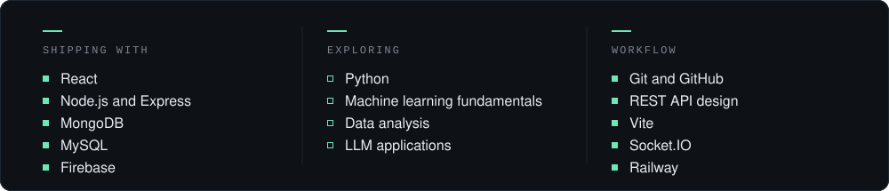

I'm a software engineer. I design and ship full-stack products, with a growing focus on machine learning and data systems.

## Selected work

| Project | What it is | Stack |
| --- | --- | --- |
| Freelancing Marketplace | Three-role marketplace (client, freelancer, admin) with proposals, contracts, messaging and an admin dashboard | React, Node.js, Express, MongoDB, Socket.IO |
| Rental Platform | Airbnb-style listings platform built for a database course, deployed on Railway | Node.js, Express, MySQL, EJS, Tailwind CSS |
| Job Application Tracker | Tracks applications and their status with client-side state management | React 19, Redux Toolkit, React Router 7 |

## Contact

[LinkedIn](https://www.linkedin.com/in/hamzah-yar-2b35b4305) · [hamzayar70@gmail.com](mailto:hamzayar70@gmail.com)
